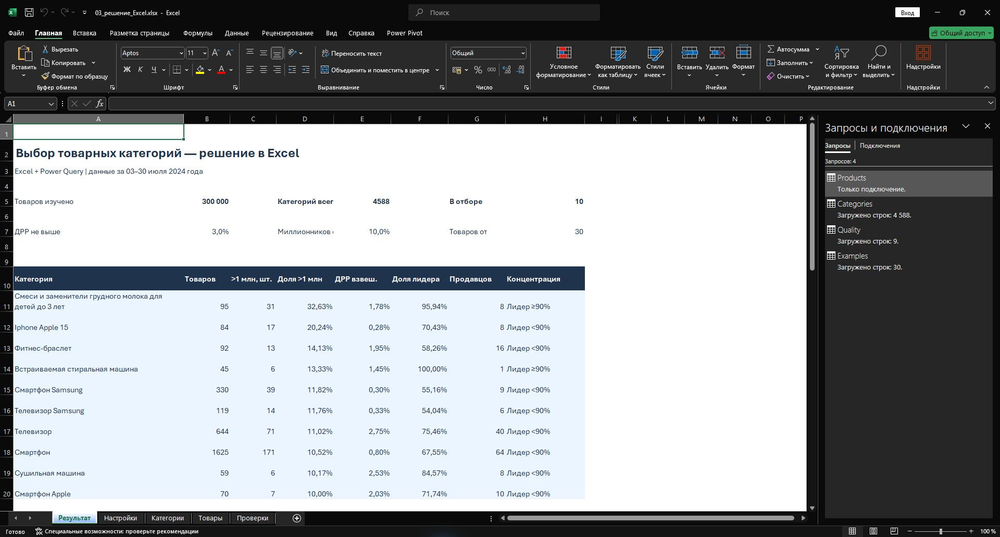
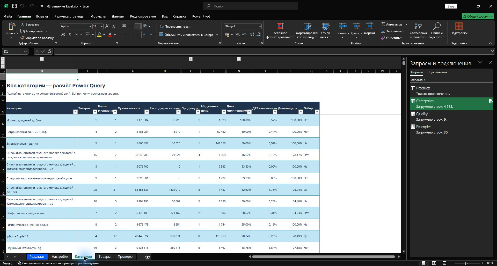
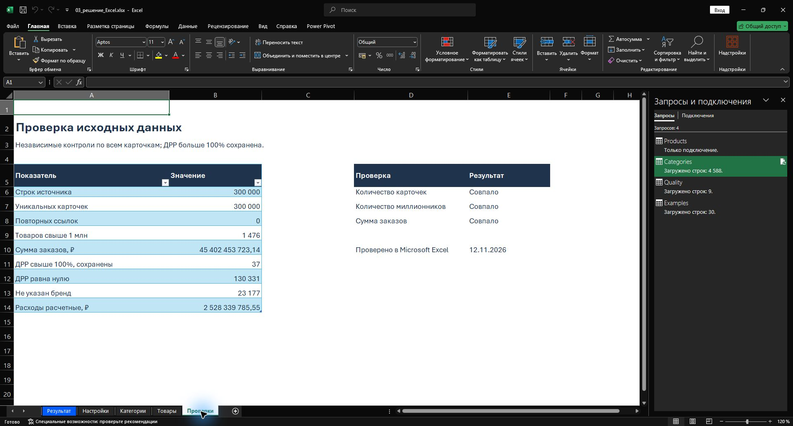

# 03. Поиск перспективных товарных категорий — решение в Excel

**Основной вариант выполнен в Microsoft Excel и Power Query.** Расчёты по исходным карточкам выполняются внутри Excel. Для открытия, изменения порогов и обновления этого варианта Python и JavaScript не требуются.

## Задача и практический результат

Найти товарные категории, в которых сочетаются небольшая доля рекламных расходов и высокая доля товаров с заказами свыше 1 млн рублей. Анализ помогает сузить список категорий для проверки поставщиков и закупочной экономики.

Исследована выгрузка из **300 000 карточек за 3–30 июля 2024 года**. «Сумма заказов» используется как доступный показатель выручки. Результат относится к предоставленной выгрузке «ТОП товаров». Название площадки и ссылки обезличены; числовые показатели сохранены.

## Открыть решение в Excel

[Скачать книгу «Решение в Excel»](outputs/03_решение_Excel.xlsx) · [Подробный конспект Excel](docs/Конспект_Excel.md) · [Протокол проверки](excel/Проверка_Excel.md)



На листе **«Результат»** видны объём данных, условия отбора и категории, прошедшие фильтр. Итоговый список пересчитывается формулами Excel при изменении порогов.

**В базовый отбор вошли 10 категорий из 4 588.** Условия: минимум 30 карточек, взвешенная ДРР не выше 3%, доля карточек с заказами строго свыше 1 млн рублей — не ниже 10%. Числовые границы выбраны для анализа и не заданы работодателем.

| Категория | Карточек | Свыше 1 млн | Доля свыше 1 млн | Взвешенная ДРР | Доля лидера |
|---|---:|---:|---:|---:|---:|
| Детские смеси до 3 лет | 95 | 31 | 32,63% | 1,78% | 95,94% |
| iPhone 15 | 84 | 17 | 20,24% | 0,28% | 70,43% |
| Фитнес-браслеты | 92 | 13 | 14,13% | 1,95% | 58,26% |
| Встраиваемые стиральные машины | 45 | 6 | 13,33% | 1,45% | 100,00% |
| Смартфоны Samsung | 330 | 39 | 11,82% | 0,30% | 55,16% |
| Телевизоры Samsung | 119 | 14 | 11,76% | 0,33% | 54,04% |
| Телевизоры | 644 | 71 | 11,02% | 2,75% | 75,46% |
| Смартфоны | 1 625 | 171 | 10,52% | 0,80% | 67,55% |
| Сушильные машины | 59 | 6 | 10,17% | 2,53% | 84,57% |
| Смартфоны Apple | 70 | 7 | 10,00% | 2,03% | 71,74% |

Названия в таблице сокращены; в книге сохранены категории источника и полный путь четырёх уровней.

## Как использовать выводы

Для первой проверки поставки выделены **смартфоны Samsung, iPhone 15 и прочие смартфоны**: у них низкая наблюдаемая ДРР и заметная доля карточек свыше миллиона. Фитнес-браслеты интересны более низкой медианной ценой. Телевизоры требуют отдельной оценки хранения, доставки и возвратов.

Детские смеси имеют самую высокую долю миллионников среди выбранных категорий, однако почти 96% заказов приходится на одного продавца. Во встраиваемых стиральных машинах доля лидера равна 100%. Прохождение числового фильтра само по себе не означает удобную нишу для нового продавца.

При ужесточении ДРР до **1%** остаются четыре категории: iPhone 15, смартфоны Samsung, телевизоры Samsung и общие смартфоны. Сценарий проверен в Excel изменением входной ячейки.

**Решение для бизнеса:** использовать список для адресной проверки поставщиков и маржи. Выгрузка не содержит закупочных цен, комиссий и возвратов, поэтому прибыльность запуска по ней не установлена. Для реальной закупки нужны актуальные данные: исходный период относится к 2024 году.

## Как устроен расчёт в Excel

1. **Power Query** читает четыре сжатых CSV из `data`, объединяет все строки и задаёт числовые типы.
2. Для каждой карточки вычисляются признак заказов свыше 1 млн рублей и оценка расходов: `сумма заказов × ДРР`.
3. Power Query группирует карточки по полному пути категории, считает количества, суммы, медианную цену и концентрацию продавцов.
4. Взвешенная ДРР равна `сумме расчётных расходов / сумме заказов`. Доля миллионников равна `числу карточек свыше миллиона / числу карточек`.
5. **Формулы Excel** проверяют пороги и перестраивают итоговый список. Power Query выбирает до трёх примеров карточек на отобранную категорию.



На листе «Категории» сохранены простая средняя ДРР и взвешенная ДРР. У них разные знаменатели; для отбора используется взвешенный показатель. Тексты встроенных запросов доступны в папке [`excel/`](excel).

## Как проверен результат



- Проверены 300 000 строк и уникальность 300 000 карточек.
- Найдены 1 476 карточек с заказами строго свыше 1 млн рублей.
- Сумма заказов составляет **45 402 453 723,14 ₽**.
- 37 значений ДРР свыше 100% сохранены.
- Суммы количества карточек, миллионников и заказов по категориям совпадают с контролями источника.
- Изменение порога ДРР с 3% на 1% меняет отбор с 10 до 4 категорий; возврат к 3% восстанавливает базовый список.

Проверка выполнена в установленном Microsoft Excel. Скриншоты показывают реальный результат в приложении.

## Как открыть и обновить

1. Нажать **Code → Download ZIP**, распаковать репозиторий с сохранением структуры папок.
2. Открыть `outputs/03_решение_Excel.xlsx` в настольном Excel для Windows с Power Query. Сохранённые результаты доступны без обновления.
3. На листе «Настройки» проверить путь к `data`. При необходимости указать полный путь. Четыре файла CSV.GZ распаковывать не требуется.
4. Изменять пороги в **A8:C8** листа «Настройки». Итоговый список и столбец «Отбор» пересчитываются сразу.
5. После замены исходных файлов выполнить **Данные → Обновить всё**. Этой же командой обновляются примеры товаров. Если Excel запрашивает разрешение подключения, проверить обращение к вашей локальной папке `data`.

| Файл или папка | Назначение |
|---|---|
| `outputs/03_решение_Excel.xlsx` | Основной вариант с запросами Power Query и формулами Excel |
| `docs/Конспект_Excel.md` | Пошаговый разбор решения, формул и выводов |
| `screenshots/` | Скриншоты готового Excel для портфолио |
| `excel/*.pq` | Запросы Power Query, уже встроенные в книгу |
| `excel/Проверка_Excel.md` | Протокол проверки |
| `data/` | Исходные строки и описание источника |

Предыдущий программный вариант сохранён в `outputs/03_анализ.xlsx`, `src/` и сопутствующих CSV/JSON. Он использует Python и JavaScript. **Основной вариант этой страницы — решение в Excel.** Технический сценарий `excel/build_native_excel.ps1` собирает книгу через объектную модель Excel; он не требуется для её эксплуатации и не рассчитывает категории вне Power Query.

<details>
<summary>Описание предыдущего программного варианта</summary>

# 03. Поиск перспективных товарных категорий

**Бизнес-задача:** В каких категориях сочетаются высокий объём заказов и небольшая доля рекламных расходов?

Ссылки на карточки и название площадки обезличены. Идентификаторы и числовые показатели сохранены.

Готовое решение: выбор категорий с низкой долей рекламных расходов и высокой долей товаров с заказами более 1 млн рублей.

## Открыть результат

- [Excel с формулами и полным списком категорий](outputs/03_анализ.xlsx)
- [Подробный конспект выполнения](docs/Конспект%20выполнения%2003.md)
- [Диаграмма категорий](outputs/category_map.png)
- [Все категории CSV](outputs/categories.csv)
- [Примеры товаров CSV](outputs/product_examples.csv)
- [Исходное задание](docs/Задание.txt)

## Основной ответ

Из 300 000 карточек сформировано 4588 категорий. По базовому правилу — минимум 30 карточек, ДРР ≤3%, доля товаров с заказами >1 млн ₽ ≥10% — отобрано 10 категорий.

| Категория | Товаров | Свыше 1 млн | Доля свыше 1 млн | ДРР взвешенная | Доля крупнейшего продавца |
|---|---|---|---|---|---|
| Смеси и заменители грудного молока для детей до 3 лет | 95 | 31 | 32,63% | 1,78% | 95,94% |
| Iphone Apple 15 | 84 | 17 | 20,24% | 0,28% | 70,43% |
| Фитнес-браслет | 92 | 13 | 14,13% | 1,95% | 58,26% |
| Встраиваемая стиральная машина | 45 | 6 | 13,33% | 1,45% | 100,00% |
| Смартфон Samsung | 330 | 39 | 11,82% | 0,30% | 55,16% |
| Телевизор Samsung | 119 | 14 | 11,76% | 0,33% | 54,04% |
| Телевизор | 644 | 71 | 11,02% | 2,75% | 75,46% |
| Смартфон | 1 625 | 171 | 10,52% | 0,80% | 67,55% |
| Сушильная машина | 59 | 6 | 10,17% | 2,53% | 84,57% |
| Смартфон Apple | 70 | 7 | 10,00% | 2,03% | 71,74% |

Для проверки поставки в первую очередь: смартфоны Samsung, iPhone 15, прочие смартфоны и фитнес-браслеты. Телевизоры Samsung — при подходящей логистике. Детские смеси лидируют по доле миллионников, но имеют высокую концентрацию у крупнейшего продавца. Подробные основания и ограничения приведены в конспекте.

**Период данных: 3–30 июля 2024 года.** Сумма заказов служит показателем выручки для задания. Результат описывает выгрузку «ТОП товаров», а не весь рынок 03. Прибыльность нового продавца и текущий спрос из этих данных не следуют.

## Воспроизведение

```bash
python -m pip install -r requirements.txt
python src/analyze.py
python src/build_report.py
```

Все 300 000 исходных строк сохранены в `data/products_01.csv.gz` … `products_04.csv.gz`; `source_row` связывает записи с оригиналом. Заголовки, период и SHA-256 исходного Excel — в [source.json](data/source.json). Большой исходный Excel хранится локально рядом с решением и не дублируется в репозитории.

`src/build_workbook.mjs` создаёт приложенный Excel через `@oai/artifact-tool` в среде Codex. Обычный повторный запуск Python пересчитывает CSV и текст; он не обновляет книгу автоматически. Для нового списка в существующей книге измените пороги и фильтруйте столбец «Отбор» на листе «Категории».

## Структура

- `data/` — полная нормализованная копия данных и описание источника.
- `src/` — воспроизводимый анализ и сборка результатов.
- `outputs/` — Excel, CSV, JSON и диаграмма.
- `docs/` — условие и подробный конспект с формулами, разбором выбора товаров и инструкцией Excel.

Контроли: 300 000 уникальных ссылок, 1 476 товаров выше миллиона, сумма заказов 45 402 453 723 ₽. Пустых обязательных полей и дублей нет. 37 значений ДРР свыше 100% сохранены. Проверены агрегаты и формулы книги; запуск в нативном Excel не выполнялся.

</details>
