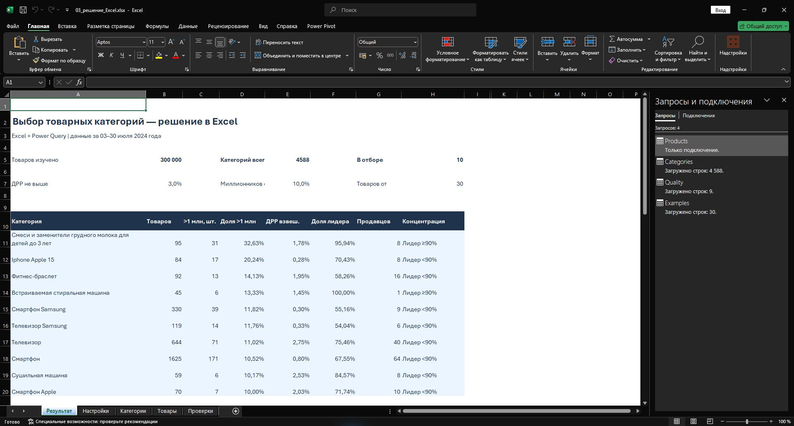

# Поиск перспективных товарных категорий — решение в Excel

## Что решает работа

Нужно выбрать категории для дальнейшей проверки ассортимента: найти сочетание низкой доли рекламных расходов и высокой доли товаров с заказами свыше миллиона рублей. Конечный результат — книга Excel с обновляемыми расчётами и конкретный список категорий, по которым стоит проверять поставку и экономику.

Этот вариант выполнен в **Microsoft Excel и Power Query**. Power Query читает все исходные карточки и рассчитывает агрегаты. Формулы Excel применяют изменяемые условия отбора и строят итоговый список. Встроенные запросы доступны через «Данные → Запросы и подключения». Обновление основного варианта не требует запуска Python, JavaScript или сценария сборки.

## 1 Что получилось

Исследованы 300 000 карточек. По полному пути четырёх уровней сформированы 4 588 категорий. При минимуме 30 карточек, взвешенной ДРР до 3% включительно и доле миллионников от 10% включительно отобрано 10 категорий.

Первая группа для проверки поставщиков — смартфоны Samsung, iPhone 15 и другие смартфоны. Фитнес-браслеты имеют более низкую медианную цену. Телевизоры требуют отдельной оценки логистики и возвратов. Детские смеси проходят фильтры с высокой долей миллионников, но почти 96% заказов категории сосредоточено у одного продавца. Во встраиваемых стиральных машинах доля лидера равна 100%.

Полученный список служит основанием для закупочной проверки. Себестоимости, комиссий и возвратов в источнике нет, поэтому прибыльность нового продавца не установлена.



## 2 Какие материалы использованы

Условие хранится в `docs/Задание.txt`. В нём требуется изучить таблицу, найти категории с низкой ДРР и высокой долей товаров с выручкой свыше миллиона, затем предложить товары для продажи.

Первоначальный Excel содержит лист «ТОП товаров», период в B6 — 03.07.2024–30.07.2024. Заголовки находятся в строке 9; данные — в строках 10–300009. В репозитории все 300 000 исходных строк сохранены в четырёх сжатых CSV. Они обезличены для портфолио: название площадки и ссылки заменены, числовые показатели и номера исходных строк сохранены.

Основная книга читает именно поставляемые с ней CSV, поэтому её можно обновить после скачивания репозитория. `data/source.json` содержит исходные названия столбцов, период и контрольную сумму первоначального Excel. Первоначальный файл не изменялся при создании варианта Excel.

Одна строка соответствует одной карточке товара. Все ссылки в выгрузке уникальны. Категория определяется сочетанием четырёх уровней, а не только последним названием: одинаковые слова в разных ветках классификатора нельзя автоматически объединять.

«ТОП товаров» — ограниченная выгрузка. Механизм её отбора не описан, поэтому доли относятся к данным файла и не показывают вероятность успеха на всём маркетплейсе. Также нельзя переносить спрос июля 2024 года на текущий период.

## 3 Как устроена готовая книга

| Лист | Назначение |
|---|---|
| Результат | Количество карточек и категорий, активные пороги, первые 30 категорий текущего отбора, выводы для проверки поставки |
| Настройки | Папка с данными и три изменяемые границы отбора |
| Категории | Все категории с исходными агрегатами, рассчитанными долями, признаком отбора и порядком в итоговом списке |
| Товары | До трёх исторических примеров карточек на отобранную категорию |
| Проверки | Независимые показатели по исходным строкам и их сопоставление с агрегатами категорий |

В книге четыре запроса: Products, Categories, Quality и Examples. Products — только подключение, 300 000 строк не дублируются на отдельном листе. Categories загружает 4 588 строк, Quality — 9 контрольных показателей, Examples — 30 примеров при базовых условиях. Исходные карточки остаются доступны в папке `data`.

## 4 Как открыть результат и обновить его

1. Скачать репозиторий через Code → Download ZIP и распаковать его полностью.
2. Открыть `outputs/03_решение_Excel.xlsx` в настольном Excel для Windows с Power Query.
3. Просмотреть сохранённый результат: для этого обновление подключения не требуется.
4. На листе «Настройки» проверить B5. Папка `data` должна содержать все четыре файла CSV.GZ. Они читаются без ручной распаковки.
5. При необходимости заменить B5 полным путём к своей папке `data`. Формула автоматического пути использует расположение книги; если после переноса она ещё показывает прежнее место, пересчитать книгу или ввести путь вручную.
6. Выполнить «Данные → Обновить всё». При запросе внешнего подключения проверить, что источник — ваша локальная папка с четырьмя файлами.

Все таблицы загрузки сохраняют результат в книге. Это позволяет показать работу на собеседовании без запуска внешних сценариев.

## 5 Импорт данных через Power Query

Для воспроизведения с нуля можно создать пустую книгу, настроить ячейку с папкой данных и добавить запросы из `excel/*.pq` через «Данные → Получить данные → Из других источников → Пустой запрос → Расширенный редактор». В готовой книге эти действия уже выполнены.

Ячейка с путём имеет имя **DataFolder**. На листе «Настройки» также создана таблица **Settings** с заголовками «ДРР», «Доля», «Товаров» и одной строкой параметров. Имена важны: на них ссылаются запросы.

Запрос Products последовательно выполняет такие преобразования:

1. Читает DataFolder через `Excel.CurrentWorkbook()`.
2. Получает перечень файлов через `Folder.Contents` и оставляет ровно четыре ожидаемых имени. Отсутствующая часть вызывает явную ошибку, а не неполный итог.
3. Распаковывает каждый файл функцией `Binary.Decompress` с `Compression.GZip`.
4. Читает CSV в UTF-8 и поднимает первую строку в заголовки.
5. Объединяет четыре таблицы через `Table.Combine`.
6. Сохраняет поля, необходимые для задачи: путь категории, идентификатор и название карточки, продавца, бренд, сумму заказов, ДРР, цену и номер исходной строки.
7. Приводит суммы, цены и доли к числам. Используется культура `en-US`, поскольку десятичный разделитель в CSV — точка. Это правило чтения файла, а не отображения чисел в Excel.
8. Проверяет обязательные поля и отрицательные значения. Непригодные входные данные вызывают ошибку, а не превращаются в нули.
9. Добавляет два расчётных столбца.

Важно различать хранение и отображение процентов: значение 0,0039 означает 0,39%. Повторно делить его на 100 нельзя.

## 6 Какие столбцы рассчитываются на уровне товара

**Признак миллионника:**

```powerquery
if [revenue] > 1000000 then 1 else 0
```

Товар с ровно 1 000 000 рублей не проходит: в задании сказано «более». Порог относится ко всему указанному 28-дневному периоду, а не к одному дню и не к календарному месяцу.

**Расчётные рекламные расходы:**

```powerquery
[revenue] * [drr]
```

Это восстановленная оценка. Отдельной суммы рекламных расходов в источнике нет. Расчёт предполагает, что ДРР относится к той же сумме заказов и тому же периоду. Если исходная площадка использует другой знаменатель или окно атрибуции, эту оценку требуется уточнить.

«Сумма упущенных заказов» не добавляется к выручке: это оценка возможных заказов, а не состоявшаяся сумма. В исходнике также нет оплаченной выручки после возвратов. Поэтому в результатах везде говорится о сумме заказов.

## 7 Группировка категорий в Excel

Запрос Categories обращается к Products и группирует данные по cat1, cat2, cat3, cat4. В каждой группе рассчитываются:

- количество карточек;
- сумма признака миллионника;
- сумма заказов;
- сумма расчётных рекламных расходов;
- простая средняя ДРР;
- количество карточек с нулевой ДРР;
- количество разных имён продавцов;
- медиана цены реализации карточек;
- сумма заказов крупнейшего продавца.

После группировки добавляются доли:

| Показатель | Расчёт | Что показывает |
|---|---|---|
| Доля миллионников | Число карточек свыше миллиона / число карточек | Какая часть карточек в категории достигла порога |
| ДРР взвешенная | Сумма расчётных расходов / сумма заказов | Рекламная нагрузка относительно общего объёма заказов категории |
| Доля лидера | Заказы крупнейшего продавца / заказы категории | Концентрация заказов в предоставленной выборке |

Например, в детских смесях 31 карточка из 95 выше миллиона: 31 / 95 = 32,63%. В смартфонах Samsung — 39 / 330 = 11,82%.

Средняя арифметическая ДРР и взвешенная ДРР не взаимозаменяемы. Если у одного товара 100 рублей заказов с ДРР 10%, а у другого 900 рублей с ДРР 0%, средняя ДРР равна 5%. Взвешенная равна (100 × 10% + 900 × 0%) / 1000 = 1%. Для оценки рекламной нагрузки на заказы категории выбран второй показатель. В книге оба показателя сохранены отдельно.

Медианная цена рассчитывается по карточкам. Она не является средней ценой всех проданных единиц. Имена продавцов используются как предоставлены: идентификаторов юридических лиц в данных нет.

## 8 Как работают условия отбора

На листе «Настройки» используются:

| Ячейка | Параметр | Базовое значение |
|---|---|---:|
| A8 | Максимальная взвешенная ДРР | 3% |
| B8 | Минимальная доля миллионников | 10% |
| C8 | Минимум карточек в категории | 30 |

Пороги выбраны аналитиком: слова «низкая» и «высокая» в задании не определены числами. Минимум 30 уменьшает влияние категорий из одной-двух карточек, но не делает выгрузку случайной выборкой и не даёт статистической гарантии.

Столбец «Отбор» в таблице tblCategories использует формулу Excel:

```excel
=IF(AND([@Товаров]>=Настройки!$C$8,[@[ДРР взвешенная]]<=Настройки!$A$8,[@[Доля миллионников]]>=Настройки!$B$8),"Да","Нет")
```

В русской версии Excel функции отображаются как ЕСЛИ и И, аргументы разделяются точкой с запятой. В файле формула хранится в стандартном формате Excel.

Все три условия должны выполняться одновременно. Округление применяется только к отображению процентов. Граница проверяется по полному числу, а не по видимому округлению.

Столбец «Позиция» последовательно нумерует строки со значением «Да». На листе «Результат» формулы MATCH и INDEX находят соответствующие строки и показывают категорию и её показатели. Поэтому изменение порогов меняет состав списка, а не только подпись или цвет. Лист показывает первые 30 результатов; при большем количестве полный отбор доступен фильтром по столбцу «Отбор» на листе «Категории».

## 9 Почему получены именно эти рекомендации

Среди категорий с низкой ДРР могут быть группы без единого миллионника. Среди категорий с высокой долей миллионников могут быть группы с высокой рекламной нагрузкой. Для задания важно пересечение двух критериев.

При базовых порогах проходят десять категорий, показанных в README и книге. В смартфонах Samsung 39 миллионников из 330 карточек при ДРР около 0,30%; в iPhone 15 — 17 из 84 при ДРР около 0,28%. Это основания включить их в первую очередь проверки поставщиков. Высокая цена смартфонов означает существенную стоимость товарного запаса, поэтому низкую ДРР нельзя считать достаточным основанием для закупки.

Фитнес-браслеты имеют 13 миллионников из 92 карточек и ДРР около 1,95%. Более низкая медианная цена позволяет рассматривать другой размер первоначального товарного запаса. Конкретный бюджет в данных не задан, поэтому финансовый план закупки не строится.

Для телевизоров Samsung наблюдаются 14 миллионников из 119 карточек и ДРР около 0,33%. При дальнейшей проверке нужны стоимость доставки, сохранность крупного товара и условия возвратов.

В детских смесях 31 миллионник из 95 карточек, но доля крупнейшего продавца — 95,94%. У встраиваемых стиральных машин — 100%. Эти значения показывают концентрацию внутри выгрузки. Причины такой концентрации из файла не устанавливаются; они не подменяются предположениями о качестве или условиях работы продавцов.

Индивидуальные карточки и категории источника могут требовать проверки соответствия названия и классификации. Категории не переклассифицировались по названию товара без подтверждения характеристик.

## 10 Как выбраны примеры товаров

Запрос Examples читает Settings и Categories, выбирает подходящие категории и присоединяет к ним исходные карточки по всем четырём уровням. Затем оставляет товары с заказами >1 млн и ДРР не выше активного порога. В каждой категории выбираются первые три карточки после сортировки по возрастанию ДРР и убыванию заказов.

Это проверяемые исторические примеры выполнения условий. Такой порядок не доказывает, что именно эти три товара наиболее прибыльны. Для связи с первоначальным файлом сохранён номер исходной строки, для поставляемых данных — идентификатор карточки.

Изменение порогов немедленно обновляет формульный список на первом листе. Примеры рассчитываются Power Query, поэтому их нужно обновить командой «Данные → Обновить всё». Это различие важно при показе сценариев.

## 11 Проверки данных и расчётов

Запрос Quality независимо обращается к исходным карточкам. Его итоговые суммы сравниваются формулами Excel с результатами Categories. Проверки не являются источником бизнес-расчётов: они только проверяют уже полученные данные.

| Проверка | Результат |
|---|---:|
| Строк исходных данных | 300 000 |
| Уникальных карточек | 300 000 |
| Повторных ссылок | 0 |
| Карточек свыше миллиона | 1 476 |
| Сумма заказов | 45 402 453 723,14 ₽ |
| ДРР свыше 100% | 37, сохранены |
| ДРР равна нулю | 130 331 |
| Не указан бренд | 23 177 |

ДРР больше 100% не отбрасывается: реклама может стоить больше полученных заказов. Пропуск бренда также не является основанием исключить карточку из анализа категории. Пустое значение, реальный ноль и ошибка преобразования не приравниваются друг к другу.

Суммы карточек, миллионников и заказов по всем категориям совпали с контролями по исходным строкам. Дополнительно все 4 588 категорий сопоставлены с ранее рассчитанными контрольными агрегатами: количества, суммы заказов и рекламных расходов, обе основные доли и концентрация совпали. Это независимая проверка нового варианта, а не загрузка старых итогов вместо расчёта Power Query.

Файл содержит встроенные запросы и подключения, формулы и сохранённые результаты. Ошибок формул в заполненных листах не обнаружено. Проверен сценарий ДРР 3% → 1% → 3%: итог меняется 10 → 4 → 10. Отдельно проверяется повторное обновление запроса Categories с сохранением расчётных столбцов Excel; подробности зафиксированы в протоколе.

## 12 Как объяснить работу на собеседовании

«Мне нужно было выделить категории для закупочной проверки по двум условиям: низкой рекламной доле и высокой доле товаров с заказами свыше миллиона. Я объединила 300 тысяч строк в Power Query, проверила типы и уникальность карточек, затем сгруппировала данные по полному пути категории. Для рекламной доли использовала отношение расчётных расходов к заказам категории. В Excel задала изменяемые пороги и сделала итоговый список на формулах. Базовый отбор дал 10 категорий, строгий — четыре. При рекомендациях дополнительно учла концентрацию продаж у крупнейшего продавца. Итоги проверила по количествам и суммам. Результат помогает выбрать направления для проверки поставщиков, но для реальной закупки нужны свежие данные и маржа».

Такую формулировку стоит использовать после самостоятельного разбора книги и воспроизведения её ключевых шагов. Она описывает содержание решения, а не подтверждает, кто именно выполнил каждый шаг подготовки файла.

## 13 Где применять этот подход

Та же последовательность подходит для выбора ассортимента, оценки рекламной нагрузки по группам товаров и проверки отчётности: сначала установить смысл показателей и уровень учёта, затем подготовить источник, рассчитать агрегаты, применить прозрачные условия и независимо сверить результаты. Пороги должны соответствовать конкретному вопросу; переносить 3%, 10% и 30 на другую задачу автоматически нельзя.

Текущий этап завершён, когда книга обновляется из поставляемых данных, контроли сходятся, изменение порогов меняет состав списка, а README показывает результат и объясняет его назначение. Для выполнения самого тестового новых рыночных данных не требуется. Вернуться к актуализации рекомендаций нужно перед реальной закупкой или при поступлении новой выгрузки.
